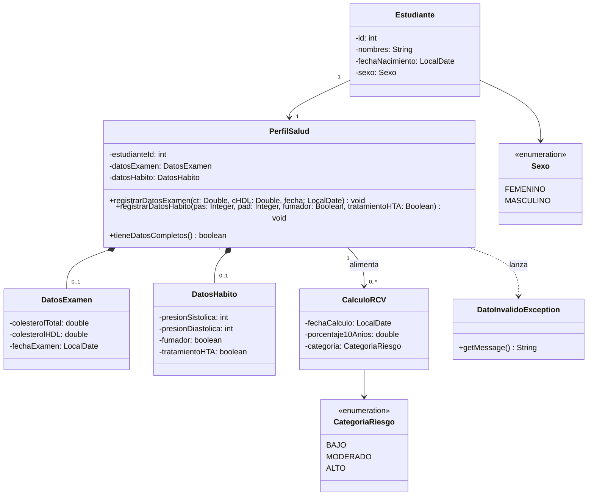

# Diagrama de clases – complemento del modelo del mundo

> **Nota:** este diagrama contiene solo las clases necesarias para HU-01 y HU-02. Debe integrarse con el diagrama del modelo del mundo que el grupo ya tiene (por ejemplo, `Estudiante` probablemente ya existe allí).

## Responsabilidades

- **PerfilSalud:** concentra los datos de salud del estudiante y valida las reglas de HU-01 y HU-02.
- **DatosExamen:** valores de laboratorio (CT, cHDL) y fecha del examen.
- **DatosHabito:** presión arterial, tabaquismo y tratamiento antihipertensivo.
- **CalculoRCV:** resultado del cálculo a 10 años; su lógica queda fuera del alcance de estas dos historias.
